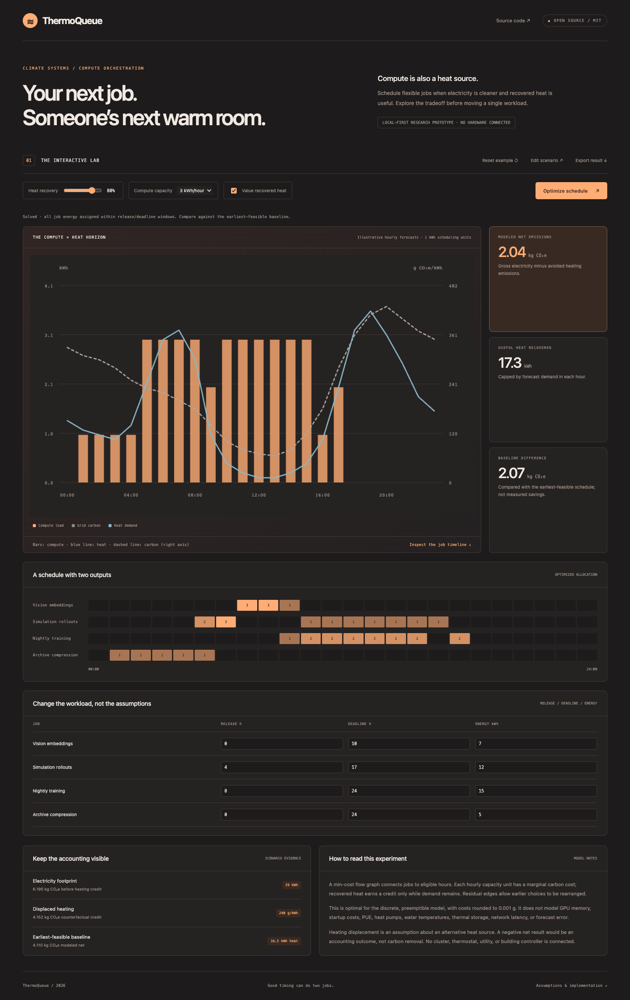

# ThermoQueue

**[Download & run locally](LOCAL.md)** — a short guide and ready-to-run ZIP.

**Compute scheduling that accounts for useful heat, not just electricity.**

Flexible compute jobs create both useful work and waste heat. Buildings may need heat at different times from the cleanest grid hours. ThermoQueue couples deadline-aware workload placement with a bounded heating credit so users can inspect both outcomes in one model.



## Try it in one command

Python 3.10+ is the only runtime dependency. There are no packages to install, API keys, accounts, build steps, external fonts, or paid services.

```sh
git clone https://github.com/rishitpradhan-gif/thermoqueue.git
cd thermoqueue
python3 server.py
```

Open **http://127.0.0.1:4312**. The server binds to loopback. Use `python3 server.py --port 8000` to choose another port.

Adjust heat recovery and compute capacity, edit each job’s release/deadline/energy, or disable the heating credit. Compare the workload bars against carbon and heat forecasts, inspect per-job allocations, then export the schedule.

The browser calls the local Python API. Scenarios are held in memory and are not persisted by the server; export files you want to keep. No request is sent to a third-party service. Use a modern browser with Canvas support.

## Use the engine without the UI

```sh
python3 cli.py examples/scenario.json --output plan.json
python3 -m unittest discover -s tests -v
```

Or import the dependency-free engine:

```python
import json
from engine import solve

with open("examples/scenario.json") as source:
    result = solve(json.load(source))
print(result["optimized"])
```

The HTTP API provides `GET /api/sample`, `GET /api/health`, and `POST /api/solve` with a scenario JSON body. Inputs are bounded and invalid scenarios return a JSON error. The server rejects cross-origin mutation requests and serves only the three explicit frontend assets. It is a development server, not a hardened multi-user service.

## What is implemented

- A real, independently callable optimization engine and local HTTP backend.
- A responsive interactive frontend with editable parameters and complete JSON scenarios.
- Scenario import, scenario export, result export, keyboard-accessible inputs, and reduced-motion support where playback is offered.
- Unit tests for constraints, failure cases, and small exact comparisons, plus HTTP tests and a ready-to-enable GitHub Actions template.
- Illustrative examples and committed desktop/mobile screenshots.

## Included example

The illustrative 24-hour fixture schedules 39 kWh of job demand. Modeled net emissions are 2.043 kg CO₂e versus 4.110 kg for the earliest-feasible baseline. This is a model comparison, not measured savings.

## Algorithm

Jobs supply integer kWh demand to a min-cost-flow graph. A job connects only to hourly slots inside its release/deadline window. Hourly capacity is split into one-kWh marginal arcs; their cost is grid carbon minus the credit for heat that can actually displace heating in that hour.

`recovered_heat[h] = min(heat_demand[h], compute[h] × heat_recovery)`

`net_carbon = Σ compute[h] × grid_carbon[h] − Σ recovered_heat[h] × displaced_heat_factor`

Successive shortest augmenting paths use a residual graph and queue-based Bellman–Ford. Reverse edges allow existing placements to be reassigned rather than locking in greedy choices. Costs are rounded to 0.001 g; the solution is optimal for that discrete linear model. The comparison schedule minimizes total hour index under the same feasibility constraints, making it an earliest-feasible baseline rather than an unconstrained immediate-start schedule.

Limits: 2–48 hourly slots, 1–16 jobs, integer 1–16 kWh/hour capacity, and at most 100 kWh per job.

## Scenario contract

- `carbon_g_per_kwh`: per-hour grid intensity, 0–2000 g CO₂e/kWh.
- `heat_demand_kwh`: useful heat demand per hour, same horizon length.
- `capacity_kwh_per_hour`: integer compute-energy capacity, 1–16.
- `heat_recovery`: fraction of compute energy available as useful heat, 0–1.
- `displaced_heat_g_per_kwh`: assumed intensity of the displaced heating source.
- `jobs`: unique name, integer `release` inclusive, `deadline` exclusive, and `energy_kwh`.

An infeasible schedule returns HTTP 400 with an explanation. No job is silently dropped.

See [examples/scenario.json](examples/scenario.json) for a complete editable input.

## Model and limitations

- Jobs are fully preemptible and divisible into one-kWh units. Real training jobs may not satisfy this assumption.
- There is no GPU memory, startup cost, runtime dependency, PUE, cooling, network, latency, or hardware constraint model.
- Heat recovery is a fixed fraction; no heat pump energy, supply temperature, thermal storage, or delivery loss is modeled beyond that fraction.
- Forecasts are illustrative. No utility, cluster, or building-management system is connected.
- Heating credits are counterfactual and depend on an assumed alternative heat source. Negative modeled net emissions would not establish carbon removal.
- Early baseline ties can produce different equally early job allocations. There is no claimed production performance advantage.

## CI template

The local GitHub credential can publish source but does not have the `workflow` scope. The tested workflow is included as [ci/github-actions-test.yml](ci/github-actions-test.yml). To enable it using a workflow-authorized credential, move it to `.github/workflows/test.yml` and push. CI is not active on this initial publication.

## Architecture

- `engine.py`: pure scenario-to-result function.
- `server.py`: standard-library HTTP server and explicit static asset allowlist.
- `cli.py`: headless JSON-file interface.
- `web/`: browser interface; no build step.
- `examples/`: synthetic, reproducible scenarios.
- `tests/`: engine and API tests.

[Mobile screenshot](docs/mobile.png) · [Contributing](CONTRIBUTING.md) · [Security](SECURITY.md)

## Research context and novelty

This is an original small software implementation and product experiment, not a claim that its underlying research topic is new. It uses established optimization methods. Related work is provided for context; no model weights, proprietary datasets, or research code are required.

- [Maximizing waste heat recovery from a building-integrated edge data center](https://www.nature.com/articles/s41598-025-22498-x) examines workload distribution and heat recovery. ThermoQueue is an independent, much smaller scheduling prototype.
- [Energy management for data centre microgrids considering co-optimisation of workloads and waste heat](https://doi.org/10.1049/esi2.12044) provides related co-optimization context.

## Possible next steps

Real forecast adapters, non-preemptible job constraints, thermal storage, PUE and heat-pump models, and a Kubernetes scheduling advisory interface are potential extensions. This repository does not submit workloads or control heating equipment.

## License

[MIT](LICENSE). Built by Rishit Pradhan. Demo scenarios are fictional and included under the same license.
